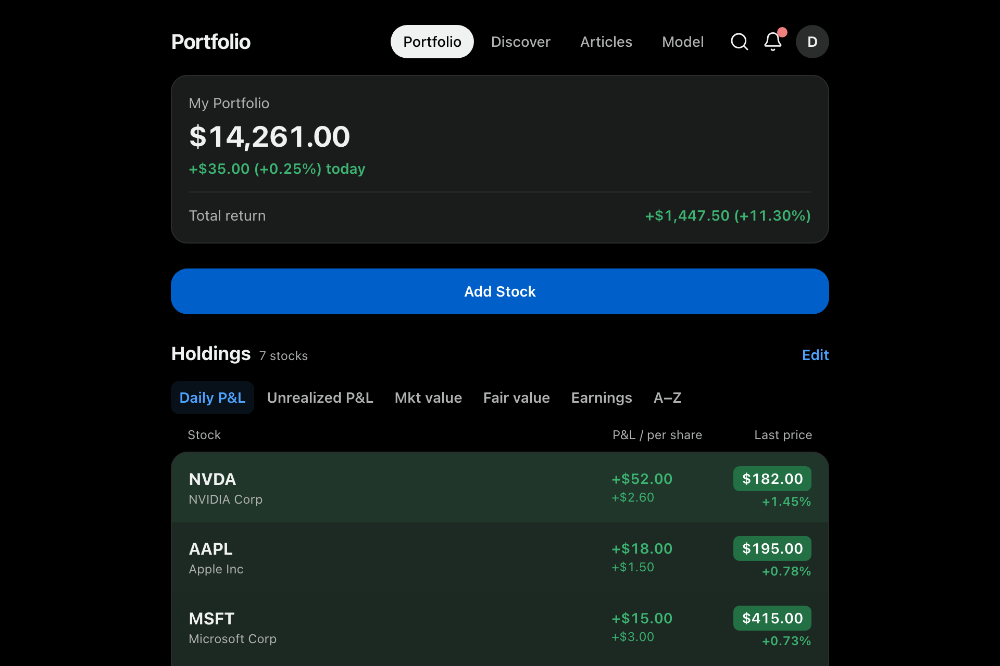
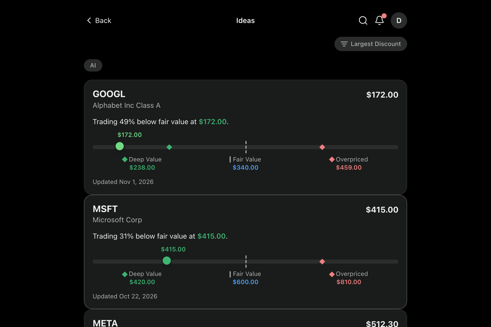
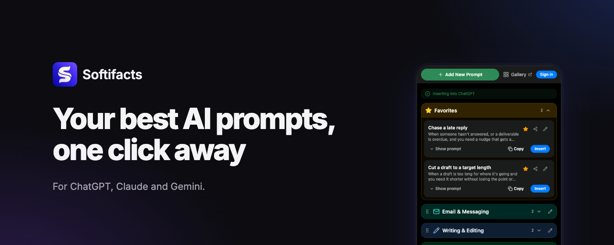

### Hi, I'm Don 👋

I'm a solo developer who builds and runs full-stack products: .NET on the server, Next.js on the web, Postgres, all deployed with Docker on my own VPS.

---

### 📈 [QuantNote](https://quantnote.app)

A stock research platform for investors: analyst reports and notes, investment themes, a public model portfolio, and your own portfolio and watchlist checked against what the analysts think.

<table>
  <tr>
    <td></td>
    <td></td>
  </tr>
</table>

- **Web app (PWA):** Next.js with typed API calls generated from the server's OpenAPI document
- **API + admin CMS:** ASP.NET Core on .NET 10, Blazor Server, EF Core + PostgreSQL, OpenIddict sign-in
- **AI chat access:** an [MCP](https://modelcontextprotocol.io) server at `mcp.quantnote.app` lets Claude and other AI chat apps read research, review your portfolio, and import holdings from a broker screenshot
- **Background services:** a data worker, an analysis engine, and a report crawler (Playwright)
- **Operations:** Docker Compose on a VPS behind Caddy, GitHub Actions deploys, Sentry monitoring

---

### 🧩 [Softifacts](https://softifacts.com)

Your AI prompts, kept in one library: a [Chrome extension](https://chromewebstore.google.com/detail/bjbpbpghnaoempbfefglofbhkodigojh) that saves prompts and inserts them on chat sites, plus a web dashboard to edit them.

- **Extension:** WXT + React
- **Dashboard:** Next.js, in a pnpm workspace that shares code and styles with the extension
- **API + admin CMS:** .NET 10, Blazor Server, EF Core + PostgreSQL, the same server stack as QuantNote

---

### 🛠️ Tech I use

`C#` `.NET 10` `ASP.NET Core` `Blazor` `EF Core` `PostgreSQL` `TypeScript` `Next.js` `React` `Python` `Docker` `GitHub Actions` `Caddy` `MCP`

### 📚 Open source

- [blind-75-python](https://github.com/cd155/blind-75-python): Blind 75 solutions in Python
- Templates for interview practice: [Blind 75](https://github.com/cd155/blind-75-python-template) · [LeetCode 75](https://github.com/cd155/leetcode-75-python-template) · [NeetCode 150](https://github.com/cd155/neetcode-150-python-template) · [NeetCode 250](https://github.com/cd155/neetcode-250-python-template)

📫 [LinkedIn](https://www.linkedin.com/in/dcengr/) · dev@softifacts.com
